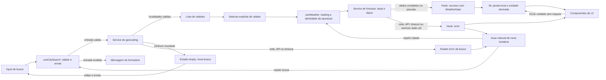

# Weather App — Plano Técnico

### Incremento P9 — hardening

- Manter a arquitetura simples e não adicionar memoização para cálculos pequenos sem evidência de custo. Criar apenas helpers puros de projeção temporal e hooks de foco/relógio quando necessário para preservar componentes curtos.
- Transporte usa corrida com sinal de abort para encerrar também corpos pendentes; finalmente remove timers/listeners. Cooldown vive em memória por origem e retryAt acompanha WeatherServiceError, nunca armazenamento persistente.
- useWeather permanece dono do estado remoto e do retry; projeção temporal é derivada de WeatherData, enquanto App mantém Unit. Status e erro têm canais semânticos separados, evitando anúncios duplicados no mesmo evento.
- Resultado da auditoria, campos externos opcionais, regressões e critérios comprovados serão registrados após executar os gates. Não afirmar validação de leitor de tela/WebKit, SLA ou limites de produção sem evidência.

#### Auditoria P9.1 — achados por severidade

| Severidade | Problema observado | Correção mínima aplicada | Evidência |
| --- | --- | --- | --- |
| Alta | Timeout dependia de fetch/json respeitarem abort; um corpo pendente podia manter loading indefinidamente. | Corrida com sinal de abort cobrindo leitura do corpo, com finally removendo timer/listeners. | Teste de JSON que nunca resolve, sinal previamente cancelado e limite 9.999/10.000 ms. |
| Alta | Nova busca apagava consulta meteorológica concluída mesmo se geocoding falhasse, contrariando AC-27. | Conservar snapshot durante geocoding e sua falha; limpar ao iniciar forecast da nova seleção; identificar “Última consulta concluída”. | Regressão inicialmente vermelha no hook, depois aprovada; E2E confirma a cidade anterior sem rótulo trocado. |
| Alta | Dados podiam parecer atuais ao envelhecer ou atravessar a meia-noite com a página aberta. | Projeção pura, aviso de estimativa antiga e reconstrução de cinco datas; timer local e visibilitychange sem fetch. | Limites de frescor, fuso distinto, DST, ano novo, pausa e cleanup em testes unitários. |
| Média | Códigos desconhecidos eram contados como dados disponíveis; horários inválidos podiam lançar erro na apresentação. | Validar WMO conhecido/unidade e normalizar para null; formatadores devolvem “Indisponível” em vez de infinito ou exceção. | Testes de campos nulos/omitidos, unidades ausentes, código 999 e valores não finitos; E2E sem NaN/undefined. |
| Média | Ausência de aria-busy e status montado/desmontado tornava o anúncio de transições menos confiável. | Região status persistente fora do main ocupado, aria-atomic, aria-busy no main/form; suprimir status duplicado nos componentes compostos. | Axe e asserções de roles/status em sucesso, loading, vazio e erro. Confirmação auditiva manual ainda pendente. |
| Média | Foco não acompanhava a conclusão; desabilitar nativamente Buscar removia o foco antes do resultado. | Foco contextual no título apenas se a pessoa permanece na busca enviada; aria-disabled com guarda de submit para duplicata pendente, preservando edição e seletor de unidade. | E2E de foco após busca e de preservação do novo termo e do botão Fahrenheit durante espera. |
| Média | HTTP 429 permitia consultas repetidas imediatamente, e parsing permissivo poderia tratar decimal como data futura. | Cooldown por origem, leitura estrita de segundos/data HTTP, botão retry desabilitado até o prazo; sem retry automático. | Testes de 60 s/data HTTP/inválidos e E2E de liberação no prazo. |
| Baixa | Borda translúcida da busca pouco distinguível do fundo. | border-slate-500, foco global de dois pixels com offset e preservação do tema. | Inspeção dos estilos e Axe sem violações nos estados auditados em 320/375/768/1440 CSS px. |

Controles principais possuem alvos de pelo menos 44 px, nomes acessíveis e suporte a teclado; o grupo de unidade usa aria-pressed e erros usam alert. Movimento reduzido permanece respeitado. Axe não é certificação de WCAG nem substitui leitor de tela, dispositivo real ou auditoria manual completa.

#### Respostas parciais P9.3 — contrato de fallback

| Campo externo | Ausente/nulo/inválido | Resultado seguro |
| --- | --- | --- |
| results | Ausente/{} ou lista vazia: empty; tipo presente incorreto: erro. | Mensagem de nenhuma cidade sem consultar forecast; retry em erro estrutural. |
| results[].id/name/admin1/country/latitude/longitude | ID ausente usa coordenadas; região/país são opcionais; nome e coordenadas válidos são obrigatórios. | Localidade inválida é descartada, todas inválidas geram erro; rótulos ambíguos recebem coordenadas. |
| timezone | Ausente ou IANA inválido. | Erro tipado, sem substituir silenciosamente pelo fuso do dispositivo. |
| current/daily/daily.time | Grupos ou array temporal obrigatórios ausentes/incorretos. | Resposta incompleta com retry, conforme P7; não sucesso vazio. |
| current.time e current_units.time | Referência ausente/inválida/unidade incompatível ou mais de cinco minutos no futuro. | Grupo atual indisponível; preservar diário utilizável. |
| temperature_2m, relative_humidity_2m, wind_speed_10m, surface_pressure | Ausência, null, tipo errado, unidade errada ou métrica fora do intervalo permitido. | Campo null e “Indisponível”; zero e temperaturas negativas continuam válidos onde aplicáveis. |
| current.precipitation | Null explícito com unidade mm vira 0, por decisão P8; omissão e unidade incompatível permanecem null. | Mostrar 0 mm somente na exceção contratada, não generalizar ausência como zero. |
| weather_code atual/diário | Ausente, null, unidade incompatível ou código desconhecido. | null no domínio, “Condição indisponível”, sem presumir céu limpo; sinalizar parcial. |
| daily.time e arrays térmicos paralelos | Elemento temporal inválido é ignorado; duplicata invalida a data; arrays curtos não deslocam índices; mínima maior que máxima invalida o par. | Cinco posições por calendário local; campos/dias ausentes indisponíveis, sem copiar outro dia. |
| precipitation_probability_max e daily_units | Ausência/null, unidade diferente de % ou valor fora de 0–100. | Probabilidade indisponível, nunca 0% inventado. |
| Instantes/valores na apresentação | Não finitos, overflow da conversão ou timestamp/fuso inválido em uso isolado de componente. | Texto “Indisponível”; nada de NaN, undefined ou infinito visível. |

#### Performance e UX P9.5

- Nenhuma memoização especulativa: cinco dias e quatro métricas são baratos; Unit continua derivada sem fetch. O relógio verifica localmente e só publica mudança de data, frescor ou cooldown, evitando render por segundo sem necessidade; pausa em segundo plano.
- Estado remoto e parâmetros de retry permanecem no hook, texto editável no formulário e Unit em App. Projeção é derivada, não uma segunda cópia persistida da consulta.
- Busca aceita edição enquanto aguarda e bloqueia apenas duplicata; atualização limpa dados meteorológicos antigos e mantém a cidade correta. Foco não é roubado se a pessoa digita outro termo ou usa a unidade.

#### Revisão de aceite P9.6

Execução final em 29/10/2026: pnpm lint, pnpm build e pnpm test aprovados; 134 testes Vitest. E2E Chromium com retries=0: 20 aprovados, incluindo Axe nos quatro estados relevantes e quatro larguras. Editor sem erros reportados. Testes automatizados não chamam a API pública.

| AC | Evidência e condição de aceite |
| --- | --- |
| AC-01 | Busca, ordenação e resultados testados; a seleção automática da primeira cidade é a substituição explícita autorizada por P7, não o texto original de seleção exclusivamente manual. Consolidar a redação histórica antes de homologar a baseline. |
| AC-02 | Homônimos, coordenadas, chave selecionada e selectCity testados em componentes/hook/services. |
| AC-03 | Mapeamento de atual, temperatura/unidade e tabela WMO cobertos nos testes de service/lib/componentes. |
| AC-04 | Ausência/null de temperatura testados; UI não usa zero como substituto. |
| AC-05 | Exatamente cinco datas locais, ordenadas e sem duplicação, em services/projeção/E2E. |
| AC-06 | Arrays paralelos, ordem alterada, mínima/máxima e condições testados; conversão aplicada aos cards. |
| AC-07 | Celsius inicial e após recarga, sem preferência persistida, cobertos no E2E. |
| AC-08 | 0/20/100/-40 °C, Fahrenheit, retorno e arredondamento nas libs; interação 0→32 e forecast no E2E. |
| AC-09 | Unidade utilizável sem dados e durante loading; resposta usa a unidade ativa, conforme componentes/E2E. |
| AC-10 | Loading, status persistente, aria-busy, edição e unidade disponíveis verificados. |
| AC-11 | Transições e foco contextual autorizados em P9 estão automatizados; confirmação real dos anúncios com leitor de tela permanece pendente. Não declarar aceite integral desse critério. |
| AC-12 | Geocoding vazio/{} não é erro de rede, não inicia forecast e mantém busca disponível. |
| AC-13 | Rede offline, HTTP e erro estrutural exibem mensagem/retry e encerram loading. |
| AC-14 | Retry repete a etapa correta, sem recarga ou geocoding extra após falha do forecast. |
| AC-15 | Cidade, unidades, referência, obtenção e fuso identificados; testes de componentes e E2E. |
| AC-16 | Resposta/erro antigo após sucesso da nova cidade não altera o estado, conforme teste do hook. |
| AC-17 | Vazio, espaços, um caractere, 101 pontos e nome Unicode de 100 pontos cobertos; validação 2–100 no formulário. |
| AC-18 | Trim, acentos, apóstrofo/ampersand, Unicode e markup como texto cobertos sem script executado. |
| AC-19 | Filtragem, limite de dez, ordem e rótulos com coordenadas testados, mantendo identidade da seleção. |
| AC-20 | Abort/cleanup, sinal previamente cancelado e corpo pendente testados nos limites; orçamento por request é a substituição autorizada em P7. |
| AC-21 | Ausências, duplicatas e par térmico inválido testados; parcial→refresh no E2E sem medições fabricadas. |
| AC-22 | Código desconhecido vira indisponível; valores negativos e zero cobertos sem fallback de céu limpo. |
| AC-23 | Fuso distinto, ano novo e travessia DST testados na projeção/calendário. |
| AC-24 | Troca durante loading aplicada à resposta sem request extra, com foco da unidade preservado. |
| AC-25 | Conversões repetidas, arredondamento, zero negativo e recarga testados. |
| AC-26 | Resposta antiga não interfere com espera/falha/substituição da consulta mais recente, conforme hook. |
| AC-27 | Corrigido e testado: respostas antigas descartadas; falha de geocoding preserva painel anterior identificado. |
| AC-28 | Refresh consulta a mesma cidade e remove snapshot antigo; falha não passa a exibi-lo como novo. |
| AC-29 | Segundos/data HTTP, cabeçalhos inválidos, bloqueio por origem e retry liberado no prazo, sem chamada automática. |
| AC-30 | Estrutura ilegível, localidades inválidas, dados inúteis e fuso inválido geram erro tipado. |
| AC-31 | Duplicata bloqueada sem reiniciar prazo; edição e operação diferente continuam disponíveis. |
| AC-32 | Limiar de duas horas, referência futura, virada local, visibilidade e projeção sem rede testados; leitor de tela manual ainda faz parte da homologação acessível. |

**Não é possível confirmar aceite total da spec.** Além da parte manual de AC-11, RNF-02 exige validação assistiva completa; RNF-03 carece de ambiente/amostra/metas aprovados; RNF-04 exige monitoramento e período real de disponibilidade; termos, privacidade de terceiros e aprovação da baseline continuam gates de produto/operação. A redação antiga de AC-01/AC-11 e dos demais trechos supersedidos deve ser consolidada com os incrementos autorizados, não ignorada como se não houvesse mudança.

WebKit/mobile foi tentado: inicialmente faltavam bibliotecas de sistema; elas foram extraídas em /tmp e disponibilizadas no cache do Playwright, sem sudo nem mudança no projeto. Para diagnosticar esse caminho não padrão, foi usado temporariamente PLAYWRIGHT_SKIP_VALIDATE_HOST_REQUIREMENTS=1, sem persistir a variável nos scripts ou na configuração. O motor passou a iniciar, mas a criação da primeira página expirou antes de carregar a aplicação. O projeto mobile não foi homologado; nenhuma asserção foi removida e a tentativa não foi marcada como aprovada. Reproduzir em ambiente com as dependências oficiais do Playwright e executar todos os projetos antes de homologar suporte WebKit.

### Incremento P8 — cobertura e estabilidade

- Reutilizar weatherService.test.ts e componentes existentes; separar testes dedicados de temperature, weatherCodes e format, sem duplicar expectativas já cobertas em testes genéricos.
- Acrescentar unitLabel e getShortDate como contratos puros e suporte de índice em formatDay preservando a chamada com data de referência. Ajustes de geocoding vazio e precipitação nula seguem a decisão P8 da spec.
- Centralizar fixtures e preparar E2E em tests/e2e/weather.spec.ts para fluxo principal, vazio {}, mobile 375×812, falha/recuperação e parcial. A suíte UI existente continua responsável por auditorias de teclado, acessibilidade e larguras extras.
- Fixar relógio compatível com os timestamps da fixture, interceptar os dois hosts, usar queries por role/label e asserções com auto-wait. Não usar sleep, waitForTimeout, networkidle nem API ao vivo como gate automatizado.

#### Resultado P8.7 — cobertura e lacunas

- Verificação em 29/10/2026: 111 testes Vitest em seis arquivos; pnpm lint e pnpm build aprovados. V8: statements 90,06%, branches 91,02%, funções 86,15%, linhas 91,66%. Relatório reproduzível com pnpm test:coverage, disponível em coverage/index.html após executar o comando.
- Nove E2E Chromium, incluindo três larguras com Axe, executados três vezes com retries=0: 27 execuções aprovadas. A suíte de jornadas inclui o viewport exato 375×812. WebKit e leitura manual com tecnologia assistiva não foram validados neste incremento.
- useWeather tem 100% de linhas e 94,11% de branches; services têm 98,95% de linhas e 89,06% de branches. O hook mock preservado para desenvolvimento isolado permanece sem testes e reduz o agregado; não foi excluído da cobertura para melhorar a métrica. App, componentes e libs têm 100% de linhas nesta execução, mas isso não garante cobertura de todas as combinações.

| Edge case / risco | Evidência atual | Lacuna remanescente |
| --- | --- | --- |
| Conversão incorreta, negativos e arredondamento | temperature.test.ts: 0/100/-40, ambas unidades, símbolo, empates, zero negativo e imutabilidade; interação 0→32 nos componentes e E2E. | Sem lacuna funcional conhecida no contrato de conversão atual; confirmar Intl nos navegadores aprovados. |
| Cidade inexistente / geocoding vazio | Vazio com results=[] ou {}, sem forecast; mensagem e busca disponíveis. | Catálogo real e cobertura geográfica não são demonstrados por mocks. |
| Input vazio, espaços, acentos e homônimos | SearchBar por Enter e botão, service com nome codificado, escolha por chave e coordenadas. | Limites de 100/101 pontos de código e marcação executável ainda merecem regressão explícita de UI em hardening. |
| Falha de API / rede | Services: HTTP 400/429/503, falha de rede, JSON inválido e limpeza de timer; E2E: erro→retry do forecast sem repetir geocoding. | Retry-After/cooldown não está implementado; testar prazo e bloqueio quando houver tarefa de implementação. |
| Timeout / cancelamento | 9.999/10.000 ms, AbortError, resposta substituída e desmontagem no hook. | Falta teste dedicado de timeout durante streaming/leitura do corpo e de sinal já abortado antes de fetch. |
| Resposta parcial ou incompleta | Grupo current/daily ausente rejeitado; campos nulos, unidades incompatíveis, arrays curtos, ordem alterada, datas duplicadas e mínima invertida; E2E parcial→refresh. | Mapear sinais de frescor e indisponibilidade temporal contínua antes de testar atualização por permanência na página. |
| Zero, condição desconhecida e referências | Métricas distinguem null/zero, exceção de precipitação nula explicitada; todos os códigos WMO e fallback; referência futura no limite e acima dele. | Aviso por idade maior que duas horas ainda depende da implementação de frescor; não adicionar teste verde que finja essa funcionalidade. |
| Datas, ano novo e fuso distinto | Hoje/Amanhã, data curta, 29/02, referência por data/índice, localidade em ano diferente de UTC e janela de cinco datas. | Travessia DST no forecast e janela que muda enquanto a página está aberta continuam pendentes de hardening temporal. |
| Mobile, teclado e contraste | Fluxo em 375×812; overflow e Axe em 320/375/1440; link de salto e controles com nomes acessíveis. | Dispositivos reais, WebKit e leitores de tela manuais não são substituídos por emulação Chromium/Axe. |

#### Resultado P8.8 — estabilidade

- Rotas e relógio ficam centralizados em mockWeatherApi; cada teste recebe contexto isolado e payloads parciais usam structuredClone. Não há API pública no caminho dos E2E.
- Usar getByRole/getByLabelText e a região nomeada “Previsão de 5 dias”; o summary nativo é identificado pelo texto visível. Nenhum seletor depende de classes Tailwind, índice estrutural de DOM ou XPath. first() limita-se ao primeiro dia de uma lista cronológica cujo tamanho é verificado.
- Await em ações e expect com auto-wait substituem esperas por tempo. Loading é mantido por Promise controlada e liberado em finally, em vez de depender da velocidade da resposta. O timeout do service usa fake timers, não espera real de dez segundos.
- Fixar Date e reduzir movimento evita envelhecimento das fixtures e capturas durante animação. Esperar domcontentloaded evita depender do carregamento de fontes externas; assertar o resultado renderizado, não networkidle. Uma repetição bem-sucedida é evidência observada, não garantia de ausência futura de flakiness.
- Próximas melhorias: adicionar a matriz WebKit quando o ambiente suportar suas bibliotecas; confirmar fluxo em dispositivo real; revisar novos testes para manter as mesmas regras de isolamento e sincronização. Não mascarar falhas aumentando sleeps ou retries.

### Incremento P7 — services e hook reais

- Consolidar searchCities e getWeather em src/services/weatherService.ts, com WeatherServiceError compartilhado e helper fetchWithTimeout em src/services/http.ts. Esses contratos passam a retornar Promise<City[]> e Promise<WeatherData>, lançando erro tipado, em vez de Result da proposta anterior.
- HTTP usa AbortController, deadline de 10 s por requisição e finally para limpar timeout/listener. Receber signal opcional permite cancelar a operação anterior sem colocar fetch no hook; erros de rede/timeout possuem mensagens uniformes. Construir o nome com encodeURIComponent e parâmetros fixos de métricas/current/daily, Celsius e timezone=auto.
- useWeather concentra dados/estados, seleção automática inicial e parâmetros de retry; App mantém somente Unit. Cada operação tem identidade e controller, de modo que nenhuma resposta antiga pode sobrescrever uma nova. Texto editável de SearchBar permanece local, distinto do último query enviado.
- Testar services com fetch mockado, hook com promises controladas e E2E interceptando geocoding/forecast. Manter fixtures apenas nos testes e no desenvolvimento isolado dos componentes; remover dependência de mock do caminho de produção.

#### Diagnóstico e revisão P7.6–P7.7

- Smoke em 29/10/2026: geocoding e forecast responderam HTTP 200 tanto na inspeção dos payloads quanto no Chromium com rede real; São Paulo exibiu cinco dias, sem erro JavaScript nem overflow em 320 CSS px. Confirmados os nomes dos campos, unidades e timezone/Unix time. Isso não comprova disponibilidade contínua nem encerra a validação de termos.
- P7.6 não trouxe mensagem de erro concreta. O defeito reproduzido durante os testes foi AbortError de outro contexto DOM ser classificado como rede por instanceof Error; corrigido por inspeção segura do nome do erro. Um erro de tipagem nos testes, por usar a opção exact do Playwright na Testing Library, também foi corrigido; não era falha da API.
- Fetch está somente em services/http.ts; weatherService valida/mapeia JSON e não importa React. useWeather importa serviços, controla concorrência/cancelamento e publica um estado de consulta atômico. App mantém Unit e deriva a apresentação, sem copiar dados do hook.
- SearchBar.query é texto em edição e seu erro é validação local; useWeather.query é o último envio e seu erro representa a operação remota. Não são cópias concorrentes da mesma responsabilidade. Fixtures e useMockWeather não são importados pelo App conectado.
- Forecast sem current ou daily é erro tipado de resposta incompleta. Ausência de campo individual em grupos presentes é disponibilidade parcial, explicitada na UI. Retry do forecast não refaz geocoding. Seleção de alternativas ocorre em details/summary nativo para não empurrar o painel para fora da primeira tela mobile.
- Pendências de hardening, não encobertas pelo aceite P7: cooldown por Retry-After de HTTP 429, anúncio/reavaliação contínua de frescor e virada local com a página aberta, auditoria manual com leitor de tela e matriz WebKit. OQ-09/OQ-10/OQ-11 e condições de publicação seguem gates próprios. HTTP 429 já possui mensagem, mas ainda não bloqueia consultas pelo prazo do cabeçalho.

### Incremento P6 — apresentação sem API

- Implementar SearchBar, UnitToggle, CurrentWeather, ForecastList/ForecastCard e componentes individuais de estado; conectar por props a App com fixture local em src/fixtures/weather.ts. Manter serviços HTTP fora desta fase.
- Estender CurrentWeather com humidityPercent, windSpeedKmh, precipitationMm e pressureHpa anuláveis; ForecastDay com precipitationProbabilityPercent anulável. Origem futura: relative_humidity_2m, wind_speed_10m, precipitation, surface_pressure e daily.precipitation_probability_max, com unidades explicitamente validadas na fase API.
- Funções puras de apresentação ficam em lib/temperature, lib/weatherCodes e lib/format; usar lucide-react para ícones meteorológicos e controles. App mantém Unit, estado da visualização e dados simulados; latência de fixture e limpeza do timer ficam em useMockWeather, sem fetch ou persistência.
- Oferecer um seletor de cenário da demonstração (idle/loading/empty/error/success), claramente associado a dados de exemplo; busca de cidade não cadastrada na fixture resulta em empty, sem afirmar inexistência real. Nenhum fallback deve apresentar dados de São Paulo como se fossem de outra cidade.
- Validar com Vitest/Testing Library, lint, build e Playwright em 320, 375 e 1440 CSS px. Este incremento satisfaz autorização local de UI, não encerra OQ-09/OQ-10/OQ-11 nem declara prontidão de produção.

## Architecture

- **Fonte da verdade:** [especificação de produto](../specs/weather-app-spec.md), incluindo a matriz de rastreabilidade.
- **Status:** plano proposto, condicionado à aprovação da baseline. Não altera a spec, não aprova suas metas e não autoriza implementação antes das tarefas correspondentes.
- **Tratamento das inconsistências:** planejar a partir de Functional Requirements e Acceptance Criteria detalhados. Edge Cases, Assumptions e Open Questions ainda contêm textos anteriores sobre timeout, fuso, retenção e atualização. A consolidação precisa ocorrer na spec antes de aprovar as tarefas; este plano não resolve conflitos de produto silenciosamente.
- **Decisão:** SPA de uma página, hospedada como arquivos estáticos via HTTPS. Sem backend, banco, autenticação, roteador, service worker ou persistência de consultas e preferências.
- **Fronteiras:** componentes apresentam dados e recebem eventos; hooks controlam operações e estado; serviços concentram HTTP e validação; funções puras fazem normalização, calendário e apresentação.



| Fronteira | Responsabilidade | Rastreabilidade |
| --- | --- | --- |
| Busca e seleção | Entrada, validação, localidades e seleção explícita. | RF-01; US-01. |
| Painel meteorológico | Atual, cinco dias, atualização e unidade. | RF-02, RF-03, RF-04; US-02, US-03, US-04. |
| Operações assíncronas | Loading, deadline, recuperação, respostas antigas e limite de uso. | RF-05, RF-06; US-05, US-06. |
| Identificação e projeção | Localidade, fuso, referência, obtenção e datas corretas. | RF-07; US-07. |

## Tech Stack

| Tecnologia | Decisão e motivo |
| --- | --- |
| TypeScript strict | Contratos de domínio e estados discriminados; JSON externo continua desconhecido até validação em runtime. |
| React 19 + Vite | Manter as versões declaradas no projeto; aplicação client-side pequena, sem SSR. |
| Tailwind CSS 3 + PostCSS | Seguir o tema dark glassmorphism do repositório, com contraste e foco verificáveis; sem nova biblioteca de UI. |
| Fetch, AbortController, URL, URLSearchParams | Integração nativa; não adicionar Axios, SDK de clima ou framework de requests. |
| Intl.DateTimeFormat / Intl.NumberFormat | Formatação pt-BR, fuso IANA, uma casa decimal e arredondamento halfExpand. Verificar suporte na matriz de navegadores antes de fechar OQ-09. |
| React useState e useRef | Estado local e controle de operações; não adicionar Redux, Context global ou biblioteca de cache. |
| Vitest + Testing Library + user-event | Funções, serviços, hooks e interação acessível. |
| Playwright | Fluxos completos, rede interceptada e viewports. |
| Biome + pnpm | Manter scripts e versões existentes; nenhuma instalação é necessária nesta fase documental. |

Sem biblioteca de datas inicialmente: instantes chegam em Unix time, apresentação usa Intl e soma de dias opera sobre datas de calendário, não sobre horas transcorridas. Se a matriz suportada exigir polyfill, registrar a dependência mínima no plano antes de implementar, sem parser temporal próprio.

## Project Structure

Estrutura-alvo, não arquivos criados por este plano. Cada componente fica em arquivo próprio. Reutilizar configurações existentes e evitar arquivos que apenas reexportam símbolos.

```text
src/
  main.tsx
  App.tsx
  index.css
  components/
    CitySearch.tsx        formulario, lista e mensagens da busca
    WeatherPanel.tsx      composicao e identificacao da consulta
    CurrentWeather.tsx    valores atuais e referencia
    ForecastList.tsx      cinco datas e campos por dia
    UnitToggle.tsx        seletor Celsius/Fahrenheit
    StatusMessage.tsx     loading, parcial, vazio e erro acessiveis
  hooks/
    useCitySearch.ts      estado da busca e concorrencia
    useWeather.ts         cidade, consulta, refresh e relogio local
  services/
    http.ts              fetch, deadline, erros e Retry-After
    geocodingService.ts   validacao externa e resultados normalizados
    weatherService.ts     validacao externa e snapshot meteorologico
  types/
    weather.ts           cidades, dados, erros e contratos publicos
  lib/
    search.ts            trim, tamanho Unicode e rotulos de localidades
    weather.ts           normalizacao e projecao dos cinco dias
    datetime.ts          datas locais, calendario e formatacao temporal
    temperature.ts       conversao e formatacao sem deriva
    conditions.ts        mapeamento WMO da spec
tests/
  unit/                  testes de funcoes puras
  integration/           services, hooks e componentes
  e2e/                   jornadas Playwright
  fixtures/              respostas controladas, validas e invalidas
  setup.ts               setup comum do Vitest
```

Os nomes e a descoberta das pastas de testes devem ser alinhados às configurações existentes na fase Tasks, sem criar um segundo runner ou configuração paralela.

| Camada | Dependências permitidas | Benefício para os testes |
| --- | --- | --- |
| components | Props, callbacks, tipos e funções de apresentação de lib. App conecta hooks aos componentes. | Renderizar loading, erro, vazio e sucesso sem chamar a API. |
| hooks | services, lib e types; não importar componentes. | Testar transições, cancelamento e concorrência com respostas e relógio controlados. |
| services | fetch, lib de validação/normalização e types; não importar React ou hooks. | Substituir fetch por mock e conferir URL, parâmetros, mapeamento e falhas. |
| lib | types e argumentos explícitos; sem React, HTTP, armazenamento ou leitura oculta do relógio. | Testar conversão, calendário e normalização como funções determinísticas. |

O tempo atual entra como argumento nas funções puras; timers e visibilitychange pertencem ao hook. Não criar classes de repositório, camada de casos de uso ou container de injeção para esta SPA.

## Data Model

Contratos TypeScript propostos, sem corpos de funções ou implementação final. Temperaturas são sempre Celsius no domínio; unidade e textos pertencem à apresentação. Identificadores de tempo e data possuem invariantes validados em runtime, não garantidos apenas pelo alias.

```typescript
type Unit = 'celsius' | 'fahrenheit';
type LocalDate = string;
type InstantMs = number;
type ServiceName = 'geocoding' | 'forecast';

interface City {
  key: string; // ID da fonte ou chave estavel pelas coordenadas.
  name: string; // Nome recebido do geocoding.
  region: string | null; // Regiao administrativa, originada de admin1.
  country: string | null; // Pais informado pela fonte.
  latitude: number; // Latitude validada, em graus decimais.
  longitude: number; // Longitude validada, em graus decimais.
}

interface CitySearchResult {
  cities: readonly City[];
  partial: boolean;
}

interface CurrentWeather {
  referenceAt: InstantMs; // Instante da estimativa atual, em epoch ms.
  temperatureC: number | null; // temperature_2m em Celsius; null se ausente.
  conditionCode: number | null; // weather_code WMO conhecido; null se invalido.
}

interface ForecastDay {
  date: LocalDate; // Data YYYY-MM-DD no fuso da cidade.
  minimumC: number | null; // temperature_2m_min em Celsius.
  maximumC: number | null; // temperature_2m_max em Celsius.
  conditionCode: number | null; // weather_code diario WMO conhecido.
}

interface WeatherData {
  city: City; // Localidade selecionada; nao e o ponto do grid meteorologico.
  timeZone: string; // timezone IANA validado, retornado pelo forecast.
  obtainedAt: InstantMs; // Momento da obtencao; nao vem da observacao da API.
  current: CurrentWeather | null; // Grupo atual; null se nao utilizavel.
  daily: readonly ForecastDay[]; // Dias normalizados antes da projecao da janela.
}

type FiveDays = readonly [
  ForecastDay, ForecastDay, ForecastDay, ForecastDay, ForecastDay
];

interface WeatherView {
  current: CurrentWeather | null;
  days: FiveDays;
  partial: boolean;
  stale: boolean;
  needsRefresh: boolean;
}

type AppErrorKind =
  | 'network' | 'http' | 'timeout' | 'rate-limit' | 'invalid-data';

interface AppError {
  kind: AppErrorKind;
  service: ServiceName;
  status: number | null;
  retryAt: InstantMs | null;
}

type Result<Value> =
  | { ok: true; value: Value }
  | { ok: false; error: AppError };

interface OperationContext {
  signal: AbortSignal;
  deadlineMonotonicMs: number;
}

interface WeatherServices {
  searchCities(
    query: string, context: OperationContext
  ): Promise<Result<CitySearchResult>>;
  getWeather(
    city: City, context: OperationContext
  ): Promise<Result<WeatherData>>;
}

interface Clock {
  now(): InstantMs;
  monotonicNow(): number;
}
```

### Invariantes e normalização

- LocalDate é uma data de calendário válida YYYY-MM-DD. InstantMs é epoch em milissegundos finitos; não confundir com os segundos da API. TimeZone é identificador IANA validado por Intl, sem fallback ao dispositivo.
- City.key usa ID da fonte quando disponível ou par de coordenadas canônicas; não usar apenas nome. Seleção e repetição conservam o objeto City original, não o texto posteriormente editado.
- Validar números sem coerção de strings: null, ausente e não finito são indisponíveis; zero continua válido. Coordenadas obedecem aos intervalos da spec.
- JSON de entrada é unknown. Validadores locais verificam estrutura, unidades e cada campo; não fazer cast direto para o domínio nem criar DTOs que presumam confiabilidade da rede.
- Diários são associados pela data, nunca pela posição presumida da tela. Arrays externos desalinhados deixam o campo sem correspondente indisponível. Datas duplicadas invalidam os registros daquele dia; mínima maior que máxima invalida o par térmico.
- O snapshot conserva dados originais normalizados. A projeção pura recebe snapshot e agora, constrói cinco datas e preenche posições ausentes com campos nulos. Não copiar temperaturas de dias vizinhos.
- Código WMO fora da tabela vira null; os textos ficam no mapeamento único da spec. Sem referência válida ou com referência mais de cinco minutos no futuro, o grupo atual não é utilizável. Temperaturas diárias ainda podem tornar a resposta parcial válida.
- Partial significa ausência de algum campo obrigatório da janela atual. Stale significa referência atual com idade maior que duas horas; são sinais independentes. NeedsRefresh marca mudança de data local desde a obtenção. Sem nenhum campo meteorológico utilizável na consulta inicial, retornar invalid-data.

## Data Flow

1. **Entrada:** CitySearch mantém texto editável separado do último query enviado; trim e contagem de pontos de código validam 2–100 caracteres antes da rede. Botão e Enter compartilham o mesmo fluxo.
2. **Busca:** iniciar operação com identidade própria e prazo de dez segundos, remover resultados anteriores, mostrar loading e chamar searchCities. A busca não apaga o snapshot meteorológico.
3. **Resultados:** validar e filtrar localidades, preservar ordem e apresentar até dez. Lista vazia válida, lista parcial e erro são resultados diferentes; seleção nunca é automática.
4. **Seleção:** repassar City ao hook meteorológico, invalidar operação anterior, remover snapshot antigo e iniciar getWeather para a cidade selecionada.
5. **Resposta:** decodificar e validar o payload, normalizar temperaturas e instantes, validar fuso e computar disponibilidade parcial. Só publicar se a operação continuar vigente e dentro do prazo.
6. **Apresentação:** projetar a janela local, converter a partir de Celsius original e formatar com uma casa decimal, halfExpand e supressão de zero negativo. A unidade atual é lida na renderização, não capturada ao iniciar o fetch.
7. **Atualização:** refresh e nova tentativa iniciam uma operação explícita com os mesmos parâmetros correspondentes. Não há retry, polling ou refetch por foco de janela automáticos.
8. **Passagem do tempo:** com a página visível e dados presentes, um timer local verifica a cada segundo se frescor ou data local mudaram; publicar estado somente quando a projeção mudar. Ao voltar à página, recalcular imediatamente via visibilitychange. Isso não chama a API nem é polling meteorológico. Suspender timer em página oculta e limpar na desmontagem; fake timers verificam os limites da spec, respeitando a disponibilidade do event loop no navegador real.

Datas da janela são obtidas por Intl no fuso e somadas como dias de calendário usando os componentes ano/mês/dia; nunca somar 86.400.000 ms a um instante local. Não interpretar YYYY-MM-DD como instante para depois exibi-lo no fuso do dispositivo.

## External APIs

Contratos-alvo a confirmar contra a documentação e respostas reais da fonte em OQ-11; não representam verificação externa já realizada. Usar URL e URLSearchParams para parâmetros, HTTPS e hosts fixos, sem credenciais, cookies ou URLs derivadas de texto do usuário.

| Serviço | Endpoint | Parâmetros planejados |
| --- | --- | --- |
| Geocoding | https://geocoding-api.open-meteo.com/v1/search | name = entrada validada; count=10; language=pt; format=json. Não restringir countryCode. |
| Forecast | https://api.open-meteo.com/v1/forecast | latitude e longitude da seleção; current=temperature_2m,weather_code; daily=temperature_2m_min,temperature_2m_max,weather_code; forecast_days=5; timezone=auto; temperature_unit=celsius; timeformat=unixtime. |

### Geocoding: exemplo resumido

Requisição ilustrativa: https://geocoding-api.open-meteo.com/v1/search?name=S%C3%A3o%20Paulo&count=10&language=pt&format=json

```json
{
  "results": [
    {
      "id": 3448439,
      "name": "São Paulo",
      "latitude": -23.5475,
      "longitude": -46.63611,
      "admin1": "São Paulo",
      "country": "Brasil"
    }
  ]
}
```

Mapear id para City.key como string com prefixo da fonte, name para name, admin1 para region e country para country; preservar latitude e longitude validadas. Não usar o nome como identidade. Um retorno vazio válido encerra em empty; uma estrutura inválida encerra em error.

### Forecast: exemplo resumido

Requisição ilustrativa: https://api.open-meteo.com/v1/forecast?latitude=-23.5475&longitude=-46.63611&current=temperature_2m,weather_code&daily=temperature_2m_min,temperature_2m_max,weather_code&forecast_days=5&timezone=auto&temperature_unit=celsius&timeformat=unixtime

```json
{
  "timezone": "America/Sao_Paulo",
  "utc_offset_seconds": -10800,
  "current_units": {
    "time": "unixtime",
    "temperature_2m": "°C",
    "weather_code": "wmo code"
  },
  "current": {
    "time": 1704110400,
    "temperature_2m": 25.3,
    "weather_code": 2
  },
  "daily_units": {
    "time": "unixtime",
    "temperature_2m_min": "°C",
    "temperature_2m_max": "°C",
    "weather_code": "wmo code"
  },
  "daily": {
    "time": [1704078000, 1704164400, 1704250800, 1704337200, 1704423600],
    "temperature_2m_min": [18.1, 19.0, 18.5, 17.3, 18.2],
    "temperature_2m_max": [28.2, 29.1, 27.0, 26.4, 28.0],
    "weather_code": [2, 3, 61, 0, 1]
  }
}
```

Os dois exemplos são fixtures ilustrativas, não respostas capturadas nem evidência de disponibilidade. O forecast representa 01/01/2024 a 05/01/2024 no fuso indicado; testar com relógio compatível, não como clima atual real. Campos não consumidos foram omitidos.

Mapear current para CurrentWeather, cada posição de daily para ForecastDay e reunir ambos em WeatherData com a City selecionada, timezone e obtainedAt do relógio local. Multiplicar timestamps Unix por 1.000 uma única vez. Aplicar Intl com o fuso IANA aos instantes para obter as datas, sem adicionar novamente utc_offset_seconds, o que deslocaria a data duas vezes. Confirmar a semântica exata dos timestamps diários no contrato real antes da implementação.

### Mapeamento de resposta

| Origem esperada | Destino e cuidado |
| --- | --- |
| Geocoding results: id, name, admin1, country, latitude, longitude | City; filtrar inválidos antes de limitar a dez. results vazio é ausência de correspondência. Campo omitido só equivale a vazio se o contrato real confirmar essa representação. |
| Forecast timezone | WeatherData.timeZone validado; coordenadas do grid retornado não substituem a identidade da cidade selecionada. |
| current.time, temperature_2m, weather_code | Referência Unix em segundos convertida uma vez para ms; temperatura e condição atual. Não atribuir ao atual o horário de obtenção. |
| daily.time, temperature_2m_min, temperature_2m_max, weather_code | Converter cada timestamp para data no fuso retornado e associar valores pelo índice de origem, antes de validar duplicações e projetar a janela. |
| current_units e daily_units | Validar as unidades retornadas; incompatibilidade térmica não pode ser rotulada como Celsius. Invalidar os campos afetados; falhar se nenhum dado utilizável restar. |

- Fazer uma única requisição de forecast com atual e diário juntos: reduz chamadas e elimina necessidade de coordenar dois fetches para o mesmo painel. Grupos ausentes no JSON geram dados parciais; falha HTTP da requisição inteira não produz um grupo bem-sucedido artificial.
- Se a resposta atravessar a meia-noite, projetar segundo a data no instante de exibição: não reutilizar ontem como hoje; preencher novo dia como indisponível e pedir atualização, sem chamada automática extra.
- Configurar fetch sem cache de resposta reutilizável pela aplicação; não adicionar cache próprio, localStorage, IndexedDB ou interceptação offline. Cache de assets estáticos não é cache de consultas.
- Verificar CORS e acesso do navegador aos endpoints. Retry-After só pode ser lido se exposto por CORS; sem acesso, tratar como cabeçalho indisponível, conforme a spec. Não presumir que um proxy é permitido: se necessário, pedir revisão de arquitetura/escopo.
- Antes de entrega, validar termos aplicáveis ao uso e volume previstos, quotas, atribuição exigida e privacidade. Inserir crédito/link conforme os termos confirmados; não declarar serviço sem custo ou SLA garantido.

## State Management

App mantém somente a unidade e conecta seleção e hooks. Texto da busca fica no formulário; seleção, snapshot e operação meteorológica ficam em useWeather. Não duplicar forecast em estado de cada componente.

```typescript
type SearchState =
  | { status: 'idle' }
  | { status: 'loading'; query: string }
  | { status: 'success'; query: string; result: CitySearchResult }
  | { status: 'empty'; query: string }
  | { status: 'error'; query: string; error: AppError };

type WeatherState =
  | { status: 'idle' }
  | { status: 'loading'; city: City }
  | { status: 'success'; data: WeatherData }
  | { status: 'error'; city: City; error: AppError };

interface ServiceCooldowns {
  geocoding: InstantMs | null;
  forecast: InstantMs | null;
}
```

- SearchState.success exige ao menos uma cidade válida; lista vazia válida resulta em SearchState.empty. Sem tentativa, permanecer idle. Entrada inválida gera erro do formulário sem transição para loading ou chamada HTTP.
- WeatherState.success admite dados parciais utilizáveis. Sem nenhum campo meteorológico válido, o estado é error, não empty, conforme a spec; sem cidade selecionada, idle apresenta o painel inicial vazio. Não adicionar um empty meteorológico que esconda uma falha de dados.
- Partial e stale meteorológicos são derivados de WeatherData e relógio, não flags redundantes armazenadas no hook. Empty é conclusão válida da busca; partial é sucesso degradado; error é falha da operação.
- App guarda Unit, inicializada como celsius. A renderização converte temperatureC, minimumC e maximumC a partir dos valores originais, sem sobrescrevê-los nem fazer fetch. A unidade atual vale para todas as respostas, inclusive as iniciadas antes da troca. Recarregar remove cidade e preferência; não há localStorage.
- Cada hook possui uma sequência de operação crescente e um AbortController ativo em refs. Substituir uma operação cancela a anterior; somente o ID atual pode publicar dados, erro ou finalizar loading. Cancelamento por substituição/desmontagem é silencioso e não vira erro de rede.
- Duplicata é o mesmo query após trim ou a mesma City.key enquanto aquela operação está pendente. Ignorar sem reiniciar prazo. Uma operação diferente é permitida, exceto durante cooldown do serviço afetado.
- Um pequeno controle compartilhado em memória dos dois serviços guarda apenas retryAt por serviço. Ele bloqueia todas as origens de nova consulta ao serviço limitado, não somente o botão “Tentar novamente”; não sobrevive à recarga.
- Timers, listeners e requisições são limpos na desmontagem. Requisições partem de ações explícitas, evitando consultas duplicadas por montagem/StrictMode. Não usar efeitos para refazer consultas ao trocar unidade.

## Error Handling

| Situação | Tratamento técnico e resultado observável |
| --- | --- |
| Entrada inválida | Erro do formulário, sem AppError de rede; mensagem associada ao input e nenhuma chamada externa. |
| Busca vazia ou parcial | Empty se lista válida vazia; success com partial se restarem cidades válidas após descarte. Mensagem em pt-BR e possibilidade de editar e enviar. |
| Rede/CORS | AppError network; encerrar loading e permitir tentativa manual. Não distinguir offline de CORS com base apenas em TypeError. |
| HTTP 5xx | AppError http; mensagem recuperável sem expor stack ou corpo da fonte. |
| HTTP 4xx diferente de 429 | AppError http com status para diagnóstico; não converter em vazio. Propor feedback de falha e tentativa manual, mas confirmar esse comportamento em OQ-06 antes de fechar tarefas. |
| HTTP 429 | Rate-limit; parse de Retry-After como segundos ou data HTTP. Converter para retryAt; cabeçalho ausente, inválido ou passado não bloqueia tentativa manual. Nenhum retry automático. |
| Dez segundos sem conclusão | Prazo monotônico único, incluindo leitura do corpo e normalização. Abort, AppError timeout, liberação do controle. Checar prazo antes de publicar para ignorar resposta tardia; timer não é garantia de tempo real sob bloqueio do navegador. |
| Cancelamento por nova operação | Ignorar completamente o resultado antigo, inclusive seu finally; não encerrar loading de operação nova. |
| JSON inválido, fuso inválido ou nenhum dado útil | AppError invalid-data; erro recuperável, não lista vazia. |
| Campo meteorológico inválido | Null e apresentação indisponível; preservar campos válidos, sinalizar parcial e oferecer refresh. |
| Referência antiga | Aviso stale sem inventar atualização nem apagar campos válidos apenas pela idade. |

Nova tentativa usa os parâmetros armazenados na operação que falhou, com novo prazo completo; o texto editável da busca permanece intacto. Ao iniciar qualquer consulta meteorológica, inclusive refresh, não manter snapshot anterior. Anunciar mensagens sem deslocar foco; somente conteúdo textual seguro chega à UI.

## Testing Strategy

Usar a matriz da spec para nomear tarefas e testes com IDs de US, RF, AC e RNF. Respostas, relógio e fusos são controlados; testes automatizados obrigatórios não dependem da API pública ao vivo. Criar fixtures reutilizáveis, sem duplicar grandes payloads por teste.

| Escopo | Ferramenta e foco | Critérios principais |
| --- | --- | --- |
| Entrada e localidades | Vitest: trim, pontos de código, limites, rótulos e coordenadas. | AC-01, AC-02, AC-17, AC-18, AC-19, AC-31. |
| Normalização e WMO | Vitest: todos os códigos, null, valores negativos, pares térmicos, duplicações e nenhum dado útil. | AC-03, AC-04, AC-06, AC-21, AC-22, AC-30. |
| Calendário e frescor | Vitest com relógio injetado: cinco datas, ano novo, DST, timezone distinto, limites de duas horas e cinco minutos. | AC-05, AC-23, AC-32. |
| Unidades | Vitest: conversões originais, halfExpand, negativos, zero negativo e ausência de deriva. | AC-07, AC-08, AC-09, AC-24, AC-25. |
| HTTP e concorrência | Vitest com fetch controlado, promises adiadas e fake timers: erros, abort, dez segundos totais, cooldown e respostas fora de ordem. | AC-12, AC-13, AC-14, AC-16, AC-20, AC-26, AC-27, AC-29, AC-30, AC-31. |
| Hooks e componentes | Testing Library: eventos reais, formulários por nome acessível, foco, loading, estados independentes e refresh. | AC-01, AC-02, AC-07, AC-09, AC-10, AC-11, AC-15, AC-24, AC-28. |
| Jornadas completas | Playwright com interceptação dos dois hosts: buscar, selecionar homônimo, consultar, trocar unidade, falhar e recuperar, timeout, parcial, concorrência e recarga. | Cobertura integrada das sete histórias; complementar, não repetir cada combinação unitária. |

### Estados de componentes e E2E mobile

- Com Vitest + Testing Library, renderizar componentes com props para idle, loading, success, empty e error da busca; para o painel, idle, loading, success completo/parcial e error. Conferir mensagens, controles habilitados, nomes acessíveis e foco. Validar o formulário via user-event; não testar detalhes internos de hooks nos testes de apresentação.
- Nos serviços, mockar fetch e verificar URLSearchParams, count=10, timezone=auto, current/daily, Celsius canônico e Unix time, além de respostas vazias, inválidas, parciais e erros. Restaurar mocks e timers após cada teste.
- No Playwright, cobrir buscar → selecionar → ler atual e cinco dias → alternar unidade sem nova chamada; falha → tentativa manual → sucesso; busca vazia → edição; timeout → recuperação; parcial → refresh; recarga → estado inicial. Conferir contagem e ordem de requests onde fazem parte do requisito.
- Repetir a jornada principal em viewport mobile de 375 CSS px, testar também o limite de 320 CSS px, alvos acessíveis, conteúdo não cortado e ausência de overflow horizontal; manter uma execução desktop de 1440 CSS px. A matriz RNF completa abaixo é adicional a essas jornadas mínimas.

### RNFs e gates

- RNF-01: verificar fluxo e ausência de overflow horizontal em 320, 375, 768 e 1440 CSS px, incluindo orientação e zoom aplicáveis. Usar screenshots para inspeção, não apenas snapshots textuais.
- RNF-02: testes por teclado e semântica automatizados mais verificação manual de anúncios por leitor de tela. Submeter matriz proposta Chromium, Firefox e WebKit, Chrome Android e Safari iOS, NVDA/Firefox e VoiceOver/Safari à aprovação OQ-09; emulação não substitui dispositivo/leitor real.
- RNF-03: medir tempo total do envio/seleção até a apresentação separadamente de leitura, validação e renderização após chegada da resposta. O timeout de dez segundos não comprova desempenho. Ambiente, amostra e percentil de aceite dependem de OQ-10; não inventar um gate aprovado.
- RNF-04: tarefa própria de hospedagem/monitoramento após OQ-10; indicador mensal da aplicação separado de sucesso da API. Testes locais não demonstram disponibilidade de 99,5%.
- RNF-05 e RNF-06: falha seguida de sucesso, datas pt-BR e mensagens em todos os estados. RNF-07: executar sem login nem credenciais e inspecionar armazenamento e integração; distinguir produto de logs de hospedagem e provedor.
- Na fase Code/Test, gates do repositório: pnpm lint, pnpm build e pnpm test. Acrescentar pnpm test:e2e para jornadas implementadas. Esta fase Plan não altera src/ ou tests/ e não executa esses gates.
- Antes do primeiro release, fazer smoke test separado e documentado dos endpoints reais, termos, CORS e unidades. Seu resultado valida a integração, mas não substitui testes determinísticos nem aprovação de produto.

## Risks & Trade-offs

| Decisão / risco | Benefício | Custo e mitigação |
| --- | --- | --- |
| SPA com chamadas diretas | Menos infraestrutura e nenhuma credencial de API. | Quotas e CORS ficam expostos ao navegador; validar OQ-11 e não introduzir proxy sem decisão explícita. |
| Fetch e dois hooks locais | Pequeno custo de dependências e estado previsível. | Concorrência e cancelamento precisam de testes; usar ID por fluxo e prazo único, sem framework genérico de requests. |
| Forecast atual + diário na mesma chamada | Menos chamadas e mesmo contexto de fuso. | Falha HTTP afeta ambos; campos ausentes podem ser parciais. Separar requisições só com justificativa e aprovação. |
| Sem cache e sem retry automático | Respeita a proposta de retenção e evita previsões antigas ou chamadas ocultas. | Mais espera e recuperação manual; mostrar estado e permitir atualização explícita. |
| Remover dados ao atualizar | Impede rotular dados antigos como novos. | Painel fica sem valores durante refresh; escolha já descrita na baseline proposta, não acrescentar stale-while-revalidate. |
| Intl e calendário simples | Evita dependência temporal adicional e parsing ambíguo. | Verificar suporte IANA/rounding e DST; adotar polyfill apenas se necessário à matriz aprovada. |
| Validação local de JSON | Poucos contratos, sem framework de schema adicional. | Testar tipos inesperados e alinhamento de arrays; se contratos crescerem, reavaliar biblioteca, não antecipar. |
| Spec ainda não consolidada/aprovada | Plano torna as decisões e seus impactos visíveis. | Não apresentar proposta como aceite: corrigir referências obsoletas e obter aprovação antes das tarefas de implementação. |

### Alternativas consideradas

- **Axios ou SDK Open-Meteo:** dispensados; dois endpoints e cancelamento nativo não justificam mais dependências.
- **TanStack Query / Redux:** dispensados; cache, refetch e retry automáticos conflitam com a baseline proposta e exigiriam configuração adicional. Reavaliar somente com crescimento real do produto.
- **Backend/proxy:** não adotado sem necessidade validada de CORS, quota ou termos. Seria mudança explícita de arquitetura, com custo operacional próprio.
- **Biblioteca temporal ou schema:** adiar até existir incompatibilidade comprovada ou expansão de contratos; manter funções pequenas e testes, sem construir framework equivalente em lib.

### Revisão do plano — P4.8

| Verificação | Resultado e ação |
| --- | --- |
| Cobertura funcional | RF-01 a RF-07 e as sete histórias possuem camada responsável, contratos, estados e estratégia de teste; AC-01 a AC-32 estão referenciados na estratégia. Isso demonstra cobertura planejada, não testes executados da aplicação. |
| Cobertura não funcional | RNF-01 a RNF-07 possuem verificações propostas. RNF-03 e RNF-04 ainda dependem do fechamento operacional de OQ-10; compatibilidade e compromisso WCAG dependem de OQ-09. |
| Aderência às instruções | Mantidos TypeScript strict, React/Vite, Tailwind dark glassmorphism, Open-Meteo sem chave, pnpm e Biome. Components, hooks, services e types seguem os diretórios exigidos; lib hospeda funções puras, sem contrariar uma convenção obrigatória de nome. Narrativa e comentários permanecem em pt-BR. |
| Fluxo SDD | Produzido apenas este documento em plans/. Não foram criados src/, testes, dependências ou código final; aprovação e tarefas continuam pré-condições para implementar. |
| Simplicidade | Dois hooks, fetch nativo e funções puras são suficientes. Sem backend, estado global, repositórios, cache persistente ou abstrações genéricas de caso de uso. |
| Ajustes realizados nesta revisão | Nomes Unit, ForecastDay e WeatherData uniformizados; funções puras em lib; success e empty explícitos; exemplos de API e caminhos vazio/erro documentados. Timer local simplificado, sem intervalo de um minuto incompatível com atualização visual em um segundo. |
| Bloqueios remanescentes | Aprovação dos refinamentos, consolidação das contradições internas da spec, contrato real da API/CORS/termos, regra de HTTP 4xx e gates operacionais. Responsáveis e decisões estão na tabela a seguir; não declarar o plano aprovado ou pronto para release enquanto estiverem abertos. |

### Pendências para aprovar o plano

| Origem | Fechamento necessário | Responsável sugerido |
| --- | --- | --- |
| OQ-01 a OQ-08 | Aprovar os refinamentos detalhados e consolidar seções antigas da spec; confirmar regra para HTTP 4xx e limites de dados parciais. Não reabrir perguntas já respondidas por proposta sem registrar o status. | Produto / UX / responsável técnico. |
| OQ-09 | Aprovar navegadores, dispositivos, leitores e compromisso WCAG; verificar Intl nos alvos. | Produto / QA. |
| OQ-10 | Aprovar orçamento e método de desempenho, hospedagem, monitoramento e responsável pela disponibilidade. | Produto / operação / QA. |
| OQ-11 | Validar documentação e payloads, unidades e timestamps Unix, representação de vazio, CORS, Retry-After, limites, atribuição e privacidade para o uso pretendido. | Responsável pela integração / produto. |
| OQ-12 | Consolidar Out of Scope: atualização manual pertence a RF-02; excluir previsão horária, autocomplete, polling, retry automático e campos adicionais não contratados, além das exclusões propostas. | Produto. |

Depois desses fechamentos, decompor em tarefas pequenas com dependências: contratos e funções puras; serviços; hooks e estado; componentes; integração das jornadas; validações de qualidade e entrega. A matriz da spec permanece a referência para cobertura, sem criar requisitos novos no backlog.